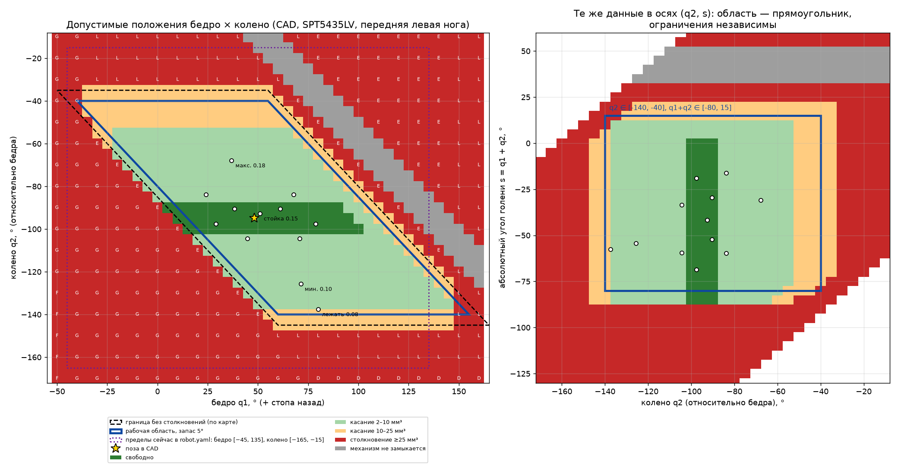

# Калибровка сервоприводов

Калибровка задаёт для каждой сервы две вещи: **`direction`** (в какую сторону она вращает сустав) и **`offset_deg`** (какой угол сустава соответствует центральному импульсу). Значения хранятся в `ros2_ws/src/dog_bringup/config/servos.yaml`. Этот каталог смонтирован в контейнер, поэтому после правки файла достаточно перезапустить контейнер, пересобирать образ не нужно.

## Автоматически: камера ноутбука

Проще всего откалибровать робота программой [`tools/autocal`](../tools/autocal/README.md). Она двигает каждую серву, измеряет углы по бумажным ArUco-меткам и сама записывает `direction`, `offset_deg`, масштаб и пределы. Ниже описана ручная калибровка: она нужна, если камеры нет или нужно проверить результат глазами.

## Тяги и связанные суставы

Если серва стоит прямо на оси сустава, оставьте `servo_arm_mm: 0.0`. Если сустав приводится тягой, задайте длину рычага сервы (`servo_arm_mm` больше 0) и геометрию:

| Поле | Что это |
|---|---|
| `servo_arm_mm` | рычаг на валу сервы (от оси до шарнира тяги); 0 = серва на оси |
| `joint_arm_mm` | рычаг на суставе; 0 = такой же, как у сервы |
| `rod_mm` | длина тяги между шарнирами; 0 = равна расстоянию между осями |
| `axis_distance_mm` | расстояние от оси сервы до оси сустава (обязательно) |

Равные рычаги и тяга, равная расстоянию между осями, дают параллелограмм: сустав поворачивается 1:1. Другие длины дают нелинейную передачу, драйвер пересчитывает её точно и не доводит серву до мёртвой точки. Предполагается, что на центральном импульсе рычаг сервы перпендикулярен линии «ось сервы — ось сустава».

Если серва колена стоит в блоке бедра на корпусе, она задаёт сумму «колено + бедро»: укажите `coupled_to: lf_thigh_joint, coupling: 1.0`, и драйвер сам будет двигать колено вслед за бедром. В поставляемом `servos.yaml` так и сделано; числа и порядок калибровки — в разделе «Колено связано с бедром: допустимая область» ниже.

## Колено связано с бедром: допустимая область

Числа этого раздела получены по CAD владельца (Fusion 360, `Full_body_case`, серва SPT5435LV вместо MG996R, 13.10.2026), на роботе они **не измерены**. Первый запуск остаётся на подставке с E-STOP и защитой по току ([DEPLOYMENT.md](DEPLOYMENT.md)).

**Механизм.** Серва колена стоит в блоке бедра, на корпусе, и тянет голень через двойной параллелограмм (кривошип 24.0, тяга 28.2, диск на оси бедра с плечами 23.9/26.9, тяга 100.0, рычаг голени 27.0, бедро 100.1). Абсолютный угол голени равен углу сервы 1:1. Поэтому серва колена задаёт не колено, а

```
s = q1 + q2      q1 — бедро (0 = вниз, «+» стопа назад),  q2 — колено относительно бедра
```

Бедро и колено ограничены не независимо: допустимая область в осях (q1, q2) — параллелограмм, а в осях (q2, s) — **прямоугольник**: 0 несовпадений из 825 клеток при q1 от 0 до 120°. Самостоятельного предела у бедра нет, он выражается через q2 и s: q1 = s − q2.



*Слева — оси (бедро q1, колено q2), справа — те же данные в осях (q2, s). Синяя рамка — рабочая область с запасом 5°; пунктир фиолетовый — прежние пределы (бедро −45…135, колено −165…−15); звезда — поза в CAD, точки — позы стойки, шагов и лежания.*

| Величина | Граница по карте (клетки 5°) | Жёсткие упоры (мелкие развёртки) | В конфиге (запас 5°) |
|---|---|---|---|
| `q2`, колено относительно бедра | −145 … −35° | −145.6 … −35.6° (бедро × `link_100mm`) | **−140 … −40°** |
| `s = q1 + q2`, голень абсолютно | −85 … +20° | −87 … +18° (кривошип/удлинитель × диск) | **−80 … +15°** |

Дополнительные упоры вне полезной области: q1 ≤ −35° (бедро × удлинитель кривошипа) и q1 ≥ 150° (мёртвая точка механизма). Касания 2–25 мм³ (коды `a`, `b` на карте) — трение бедра о диск или голень при отклонении q2 от опорного на 10° и больше, это не блок. Отведение `hip`: наружу свободно не менее +70° (касание около +78°), внутрь упоры 39–41°; замеренные у владельца `hip_out` 54° и `hip_in` 36° с этим совместимы, hip не менялся.

**Что записано.**

- `min_deg: -140.0`, `max_deg: -40.0` у четырёх `*_calf_joint` и `description.calf_limits_deg: [-140.0, -40.0]` в `robot.yaml` (то же число в URDF для Gazebo; контрактный тест требует их равенства);
- `coupled_to: <нога>_thigh_joint`, `coupling: 1.0`, `servo_arm_mm: 0.0` (параллелограмм = передача 1:1, длины тяг не нужны);
- окно сервы колена равно допустимому диапазону s: `offset_deg: -32.5` (середина окна) и `range_deg: 95.0`, то есть s от −80 до +15°;
- импульсы сдвинуты на 12.5° (118 мкс), чтобы **1370 мкс оставался монтажной позой s = −45°** (бедро 45°, колено −90° — «все серво по центру»): левые ноги (`direction: 1`) 1039.5 / 1936.5 мкс, правые (`direction: -1`) 803.5 / 1700.5 мкс; наклон 9.44 мкс/° (как у 520…2220 мкс на 180°). Середина окна импульсов 1488 / 1252 мкс — это s = −32.5°, а 1370 мкс — s = −45°.

Нового кода в драйвере для этого не потребовалось: `jointToPulseUs` уже зажимает и угол колена (в `min_deg…max_deg`), и сумму `q + coupling · бедро − offset_deg` (в ±`range_deg`/2), считает зажатые и пишет предупреждение `joint(s) clamped`. Пара «бедро 100°, колено −60°» (сумма 40° > 15°) зажимается, центр области — нет (тесты `CoupledKnee` в `test_servo_driver.cpp`, контракт в `tools/robot_setup/test/test_yaml_contract.py`).

**Калибровка.** У связанного колена `offset_deg` — это **s при середине окна импульсов**, а не угол колена. Опорная поза связанного колена — монтажная `calib_pose 0 45 -90` (s = −45° на 1370 мкс); поза по умолчанию `calib_pose 0 0 -90` даёт s = −90°: окно зажмёт её до −80°, и в карте CAD это клетка столкновения. Сдвиг импульсов на 12.5° сделан для того, чтобы 1370 мкс был s = −45°, как в сборочной опоре; поза в CAD даёт около −47°.

Порядок: поставьте колено на 1370 мкс (`pca9685_probe pulse <канал> 1370`), измерьте s0 (угол голени относительно вертикали, угольником или уровнем). Если s0 отличается от −45°, есть два пути.

1. **Сдвинуть оба импульса** этой строки на `direction · (−45 − s0) · 9.444` мкс. `offset_deg` −32.5 и `range_deg` 95 остаются, реальное окно остаётся −80…+15°. Без сдвига реальное окно уезжает на s0 + 45° и остаётся внутри жёстких упоров −87…+18° только при s0 от −52° до −42°.
2. **Сузить окно симметрично** относительно нового центра: `offset_deg` = s0 при центральном импульсе 1370 мкс, `range_deg` = 2 · min(s0 + 80, 15 − s0), импульсы = 1370 ± `range_deg`/2 · 9.444. Пример s0 = −47°: `range_deg` 66, импульсы 1058.3…1681.7 мкс, окно −80…−14° — всё ещё накрывает ход −69…−16°.

Если окно перестало накрывать s от −69° до −16°, сдвиньте рожок на один зуб шлица. После каждой правки: `python3 -m pytest -q tools/robot_setup/test/test_yaml_contract.py` — тест падает, если окно вышло за упоры −87…+18° или перестало накрывать ход. Тест монтажной позы (`test_the_mount_pose_is_the_centre_pulse_of_the_knee`) проверяет допущение «на 1370 мкс s = −45°»: после замера s0 ≠ −45° он упадёт специально — подставьте измеренное s0 в константу `MOUNT_S_DEG` теста (при обоих путях выше 1370 мкс тогда соответствует s0). Страница `servo_pose` и скрипт `servo_pose_apply.py` строки со `coupled_to` пропускают и пишут об этом; `offset_deg` колена ставится вручную или вживую через `ros2 param set /dog/servo_driver lf_calf_joint.offset_deg -32.5`.

**Что укладывается в область.** Стойка, ходьба и лежание для трёх наборов длин (config 105/105, замер 100/111, CAD 100/116.6): q1 18…80°, q2 −138…−63°, s −69…−16°; самый малый запас 4° — лежание на 0.08 м при голени 111 мм (q2 −135.8°). Прогон `LocomotionController` без ROS (стойка, лёжа, минимальная и максимальная высота, наклоны, ходьба на полной скорости по vx, vy, wz) укладывается в окно, наименьший запас по s у ходьбы на минимальной высоте (−78.3° при окне −80°).

**Известные конфликты** (открытые пункты — [REVIEW.md](REVIEW.md), п. 29–32):

- `greet` (колени на землю, голени плашмя) требует s около −90° у задних ног и до −121° у передних, это за жёстким упором (−87°) и за окном (−80°): драйвер зажмёт, голень останется примерно на 10° выше горизонтали (п. 31);
- ползком (`crawl`) на полной команде vy и wz колено выпрямляется почти до 0° и s доходит до +31°, на ровном полу вперёд q2 доходит до −39.9° (п. 29);
- `thigh_limits_deg` min −45° лежит ниже упора q1 ≤ −35°; по указанию владельца не менялся, ход никогда не уходит ниже q1 18° (п. 32).

## Соглашение об углах

Ноль всех суставов означает, что нога висит строго вниз и выпрямлена:

| Сустав | Ось | Положительный угол |
|---|---|---|
| `*_hip_joint` | X (вдоль корпуса) | стопа уходит **влево** (у левых ног наружу, у правых внутрь) |
| `*_thigh_joint` | Y (поперёк) | стопа уходит **назад** |
| `*_calf_joint` | Y | колено разгибается вперёд. Рабочие углы отрицательные: колено согнуто назад, −90° — прямой угол |

```
pulse = centre + direction · (угол − offset_deg) · мкс_на_градус
centre = (pulse_min_us + pulse_max_us) / 2   → 1370 мкс в v1
```

## 0. Подготовка

- Поставьте робота на подставку так, чтобы ноги висели свободно.
- Подайте питание на сервы и остановите основной стек: `docker compose stop`.
- Во втором терминале будет работать только драйвер, без контроллера походки:

```bash
docker compose run --rm robot ros2 run dog_hardware servo_driver_node \
  --ros-args -r __ns:=/dog \
  --params-file /ws/install/dog_bringup/share/dog_bringup/config/servos.yaml
```

## 1. Проводка (до драйвера)

```bash
docker compose run --rm robot ros2 run dog_hardware pca9685_probe check      # чип отвечает, 50 Гц
docker compose run --rm robot ros2 run dog_hardware pca9685_probe pulse 0 1370
docker compose run --rm robot ros2 run dog_hardware pca9685_probe off
```

Пройдите каналы 0…11 и убедитесь, что шевелится нужная серва (таблица каналов в [HARDWARE.md](HARDWARE.md)).

## 2. Опорная поза

В третьем терминале:

```bash
docker compose exec robot ros2 run dog_bringup calib_pose          # 0 / 0 / −90
```

Все ноги должны встать так: **нога вертикально, бедро строго вниз, голень под прямым углом назад.** Удобно проверять угольником.

> Колено связано с бедром, поэтому его опорная поза — монтажная `calib_pose 0 45 -90` (s = бедро + колено = −45°), см. раздел «Колено связано с бедром: допустимая область». Поза `0 0 -90` даёт s = −90°, окно колена зажмёт её до −80°.

## 3. Направления (`direction`)

Меняйте по одному суставу и смотрите, куда уходит стопа:

```bash
ros2 run dog_bringup calib_pose 15 0 -90     # hip +15°: КАЖДАЯ стопа уходит ВЛЕВО
ros2 run dog_bringup calib_pose 0 20 -90     # thigh +20°: стопы уходят НАЗАД
ros2 run dog_bringup calib_pose 0 0 -60      # calf −60°: колени разгибаются
```

Если сустав повернулся не в ту сторону:

```bash
ros2 param set /dog/servo_driver rf_hip_joint.direction -1
```

> Если при `hip +15` нога качнулась **вперёд или назад**, а не вбок, значит схема ноги отличается от принятой в v2 (см. [HARDWARE.md](HARDWARE.md), раздел «Геометрия ноги»). Дальше не продолжайте: сообщите, и кинематику нужно будет поменять.

## 4. Нули (`offset_deg`)

Вернитесь в опорную позу (`calib_pose`) и подстройте каждый сустав, пока нога не встанет ровно:

```bash
ros2 param set /dog/servo_driver lf_thigh_joint.offset_deg 47.5
```

Сервы сразу переходят в новое положение. Шаг PCA9685 ≈ 0.5°, люфт MG996R 1–2°, поэтому точнее 1° подбирать нет смысла.

### Подстройка страницей (до запуска стека)

Пока драйвер ещё не запускается, монтажные положения удобно подстроить страницей
`tools/servo_pose/servo_pose_server.py` — она пишет в PCA9685 напрямую, без ROS,
и помнит накопленную подстройку. У каждого из 12 суставов кнопки **±1°** (шаг в
углах сустава): у правых ног с `direction: −1` импульс меняется зеркально — это
сразу видно глазом и проверяет инверсирование. «Держать» = 1370 мкс + подстройка
канала (монтажная поза).

**Проверка направления.** У каждого сустава есть кнопки-шаги на 12°: плечо —
«внутрь/наружу», бедро — «вперёд/назад», колено — «вверх/вниз». Эталон: наружу —
стопа от корпуса, вперёд — стопа к носу, вверх — голень складывается. Двинулось
наоборот — нажмите «инвертировать direction» у этого сустава (страница сама
поправит `direction` в `servos.yaml`, бэкап `.bak`) или поменяйте знак в файле
вручную — страница читает `direction` на лету, перезапускать её не нужно. Каждый шаг идёт
с контролем тока шины (INA219): при токе больше 1.5 А движение останавливается,
канал отпускается — упор или заклинивание не жжёт серву. Ток шины виден на
странице у «связь».

Перенос подстройки в этот конфиг — кнопкой «Перенести в servos.yaml» на странице
или скриптом (дальше значения читают ноды как обычно):

```bash
# servo_pose_trim.json — файл со страницы (лежит рядом со скриптом на Pi)
python3 tools/servo_pose/servo_pose_apply.py --trim servo_pose_trim.json \
        --servos ros2_ws/src/dog_bringup/config/servos.yaml --write
```

`offset_deg = опорный угол − подстройка` (hip 0°, thigh +45°, calf −90°);
без `--write` — сухой прогон с отчётом.

## 5. Сохранение

```bash
ros2 param dump /dog/servo_driver > /tmp/servo_driver.yaml
```

Перенесите `direction` и `offset_deg` в `ros2_ws/src/dog_bringup/config/servos.yaml` на хосте и сделайте коммит.

## 6. Пределы

`min_deg` / `max_deg` — это пределы сустава в той же системе углов. Проверьте крайние положения через `calib_pose` на малом шаге: нога не должна упираться в корпус или соседние детали. Драйвер ограничивает команды пределами и диапазоном сервы и пишет предупреждение `joint(s) clamped`.

Пределы колена взяты из карты столкновений CAD (колено −140…−40°, окно сервы по s = бедро + колено −80…+15°), а не замерены; как держать окно при калибровке — в разделе «Колено связано с бедром: допустимая область».

## 7. Первый запуск

1. Робот всё ещё на подставке: `docker compose up -d`, откройте веб-страницу, нажмите «Встать» и дайте немного скорости. Ноги должны шагать ровно, без рывков и щелчков.
2. Поставьте робота на пол, нажмите «Встать» и дайте малую скорость вперёд. **Палец держите на E-STOP.**
